# Two Worlds

**A living watch face for the Garmin Forerunner 735XT.** A small moss-like
organism grows across the screen over the day, fed by my steps, heart rate
and sleep. A hard-edged digital clock sits on top of it, split off by a
single white line. The moss starts each morning as a bare root star and ends
the day as a record of how I lived it.

<p align="center">
  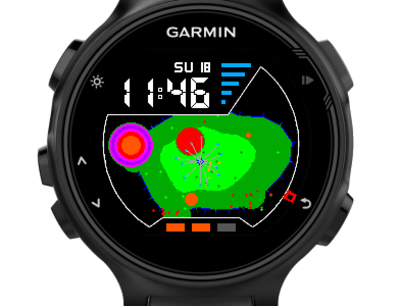
  <br><sub>The real face running in Garmin's simulator, loaded with the sample HIIT day used throughout this page</sub>
</p>

<p align="center">
  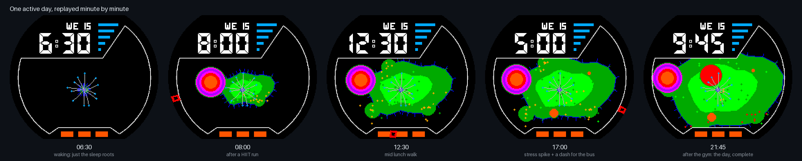
</p>

| | |
|---|---|
| **Device** | Garmin Forerunner 735XT (2016): Connect IQ API **2.4**, 215×180 semi-round transflective screen, **14 fixed colours** |
| **Budget** | **64 KB** RAM for the whole face · **one redraw per minute** · a watchdog that kills any redraw over **~25k VM instructions** |
| **Stack** | Monkey C (Garmin's language), a Python model of the display for design work, headless Garmin SDK in cloud containers |
| **Timeline** | June – October 2026 · 185 commits · 25 pull requests |
| **Status** | Running on my wrist. Sideload `bin/two-worlds-v2.prg` ([how](docs/sideload.md)) |

---

## Contents

- [The brief](#the-brief)
- [Reading the face](#reading-the-face)
- [The design process](#the-design-process)
  1. [Groundwork: a framework for a 2016 watch](#1-groundwork-a-framework-for-a-2016-watch)
  2. [First generative concepts](#2-first-generative-concepts)
  3. [Designing the chrome](#3-designing-the-chrome)
  4. [A faithful sandbox](#4-a-faithful-sandbox)
  5. [V1: BioBloom, the slime-mould dish](#5-v1-biobloom-the-slime-mould-dish)
  6. [V2: from clocks to moss](#6-v2-from-clocks-to-moss)
  7. [Tuning the organism](#7-tuning-the-organism)
  8. [Polishing the chrome](#8-polishing-the-chrome)
- [Engineering inside 64 KB](#engineering-inside-64-kb)
- [Working with Claude](#working-with-claude)
- [Repository map](#repository-map)

---

## The brief

The Forerunner 735XT is a 2016 running watch that still does its job well.
Its watch faces are the weak spot: mostly plain dials or dense data
dashboards. I wanted one that was mine, and I started with this list:

- **Reflect my actual day, not just the time.** Movement, heart-rate effort
  and last night's sleep should *shape* the face. A glance should say "big
  day" or "lazy day" without reading a single number.
- **Feel organic and generative.** Something that grows and is different
  every day, not a gauge that fills up. Deterministic, though: the same data
  should always draw the same picture.
- **Stay a good watch.** A large, legible clock, the date, battery, and
  status indicators, readable at a glance mid-run.
- **True north without a compass.** The 735XT has no magnetometer, but it knows
  the time and roughly where I am. That's enough
  to compute the sun's position and turn the watch into a **sun compass**.
- **Respect the hardware.** Nothing from newer Connect IQ versions compiles
  for this watch, and the limits are hard: 64 KB of RAM, 14 colours, no
  anti-aliasing, one redraw a minute, and a watchdog that kills any redraw
  that runs too long.

Early on this settled into one idea, **two worlds**: a crisp, *artificial*
instrument layer (clock, date, gauges) over an *organic* layer that grows
from my biometrics, split by a single white border.

---

## Reading the face

<p align="center">
  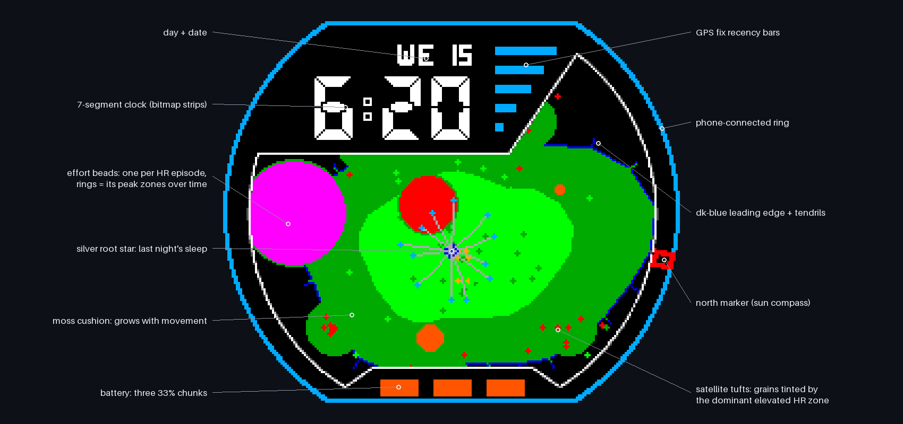
</p>

**The organic world: MossGrove.** Time of day is deliberately *not*
encoded. The moss is a summary of the day so far, rebuilt as each minute
arrives.

| Signal | Becomes |
|---|---|
| Total movement (steps, weighted by effort) | Size of the central **cushion**; **satellite tufts** bud off the rim as activity builds up |
| Minutes in elevated HR zones | Tuft grain colour = the **dominant elevated zone** |
| Each elevated-HR episode | An **effort bead**. Size grows with the episode's magnitude; concentric **growth rings** record its peak zone over time, centre outward |
| Last night's sleep | The silver **root star** at the heart. Hours slept set root count and length; each wake-up **snaps a root** at a white speck |
| The date | A per-day seed for the cushion's lobe count, tilt and outline |

The big ringed bead in these pictures is a 48-minute HIIT run. Read from
the centre out, its rings follow the session: orange warm-up, then red,
pink, **purple** (the all-out rep), pink and red intervals.

The colour ramp follows Garmin's own heart-rate zones (blue → green → amber
→ orange → red → magenta → purple), and the palette is split on purpose:
**warm colours mean effort, the night palette (silver, blue, grey, white)
means sleep**, so the two can't be confused at a glance.

**The artificial world: the chrome.**

| Element | Meaning |
|---|---|
| 7-segment clock + day/date | Bitmap glyph strips; follows the watch's 12/24 h setting |
| Five stepped bars | GPS fix age: **blue** = fix within 24 h, **amber** = older, **grey** = none (falls back to a location set in the app settings) |
| Blue ring around the glass | Phone connected |
| Three orange chunks | Battery, draining right to left; the last chunk turns grey at 10% |
| Red hollow square on the edge | **Sun compass.** Point 12 o'clock at the sun and the marker points to true north. Shown only while the sun is up and below ~80° |

<p align="center">
  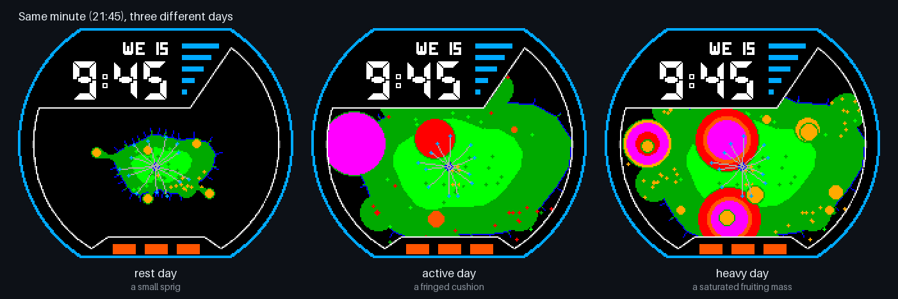
</p>

<p align="center">
  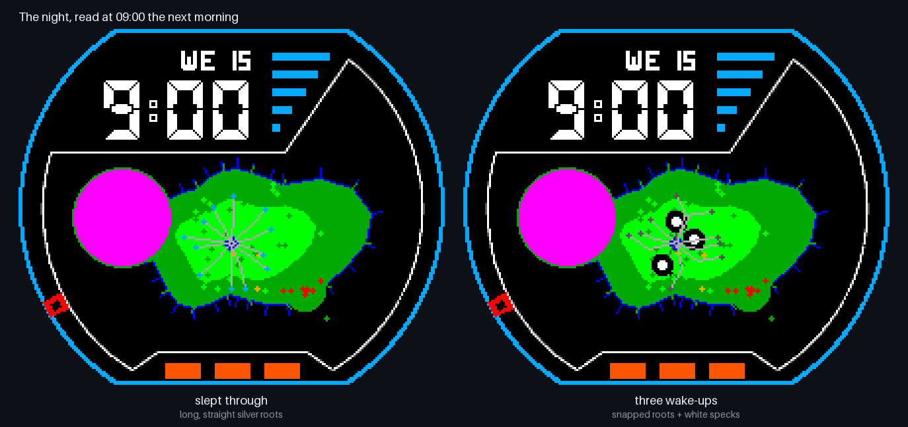
</p>

And for the days the moss outgrows its dish, there's an easter egg:

<p align="center">
  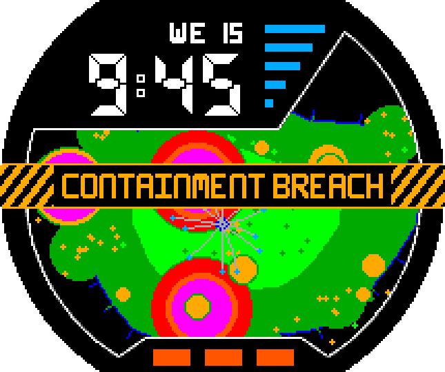
</p>

---

## The design process

Every visual decision went through the same loop: **prototype in a Python
model of the watch → render comparison sheets → I pick or redirect → only
then port to Monkey C, build, test in the simulator, and wear it.** Almost
every image below is one of those comparison sheets, straight from
[`sketches/out/`](sketches/out).

### 1. Groundwork: a framework for a 2016 watch

Before any design work there had to be a way to build for this watch at
all. Garmin's current SDK (9.2.0) still targets API 2.4, but its tools
assume a desktop with a GUI. The first week went into:

- A **multi-face Monkey C framework**: one shared core (data snapshot,
  compositor, 7-segment and bitmap-strip text, astronomy, debug overlay) and
  thin per-face folders.
- **Self-provisioning scripts** that install the SDK, device files, signing
  key and a headless simulator inside a fresh cloud container, plus a lint
  that rejects any API newer than 2.4.
- A one-screen **`flashtest`** face to prove that sideloading onto the real
  watch worked, and **`devface`**, a deliberately unstyled testbed.
- The **sun compass**: NOAA solar-position maths ported to integer-safe
  Monkey C (no `atan2` or `floor` at this API level) and unit-tested
  against reference values.

The first generative layer was Conway's Game of Life. It was cut within a
day: technically fine, but it said nothing about *me*.

### 2. First generative concepts

Three candidate "biometric art" engines, sketched in Python on a rough mock
of the display, each shown at 07:50 (mid-run), 13:05 (after lunch) and 21:45
(end of day):

<p align="center">
  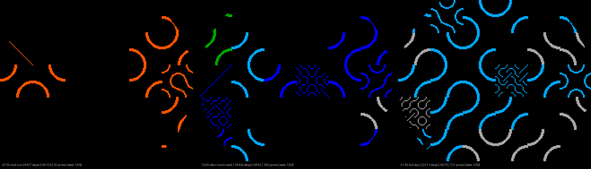
  <br><sub><b>Weathered Truchet</b>: arc tiles unlock through the day; step count sets their scale, HR their colour</sub>
</p>

<p align="center">
  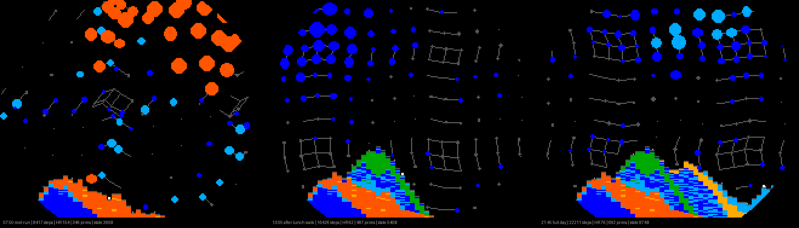
  <br><sub><b>Strata + flock</b>: the day settles as heart-rate-coloured sediment (the past) under a murmuration of dots (the present minute)</sub>
</p>

Strata + flock became the first real face, **`strataflock`**, and proved
the whole pipeline on the simulator:

<p align="center">
  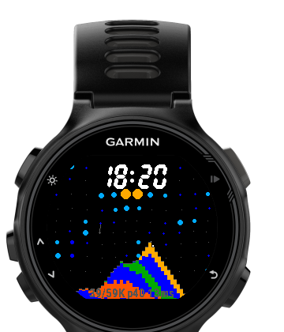
</p>

### 3. Designing the chrome

I designed the clock and gauges by hand, starting from the pixel-art first
pass shown in [Working with Claude](#working-with-claude): big 7-segment
time, day and date, signal bars, battery chunks, and a white border with a
slanted notch that frames the organic field. To check that design against
the real screen, I rebuilt it in **Claude Design**, set up as a
pixel-accurate studio. The prompt in
[`docs/claude-design-prompt.md`](docs/claude-design-prompt.md) encodes every
device rule (exact 215×180 semi-round mask, the 14-colour palette with a
pass/fail checker, no anti-aliasing, mock data panels with stress presets
like 23:59 and "everything null"), so my layout could be checked against
the real constraints before any Monkey C was written.

A second prompt, [`docs/claude-design-handoff.md`](docs/claude-design-handoff.md),
exports a finished design as a build spec: real glyph-strip PNGs, element
table, data bindings named after the code's own fields, and keep-out
rectangles. That made the port to Monkey C mechanical. The organic field
started as a flat green placeholder, and filling it took the rest of the
project.

### 4. A faithful sandbox

A full build-and-simulate cycle takes minutes. That's too slow to judge
art. So the next tool was [`sketches/device.py`](sketches/device.py), a
*faithful* Python model of the watch rather than a loose mock:

- the hash, integer sine table, HR-zone mapping and palette are
  **bit-identical** to the Monkey C core;
- integer division matches Monkey C's truncation (`-6200 / 127` is `-48` on
  the watch, not Python's `-49`);
- drawing exposes only the real `Graphics` calls, counts every one as a
  watchdog estimate, and snaps colours to the palette.

`scrub.py` replays a simulated day minute by minute and renders a captioned
strip in under a second. Because the primitives match one-to-one, an
approved sketch ports to Monkey C almost line by line, and
`strataflock.py` is kept as a parity reference against the real simulator
capture. The workflow rule became: **no Monkey C until the sandbox render
is approved.**

### 5. V1: BioBloom, the slime-mould dish

The first organic layer for two-worlds grew **from the centre outward**.
Four directions were sketched:

<p align="center">
  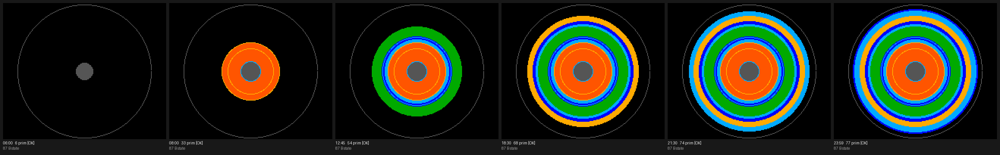
  <br><sub><b>chronodish</b>: concentric effort bands. Legible, but a chart, not an organism</sub>
</p>

<p align="center">
  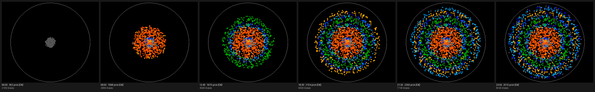
  <br><sub><b>colony</b>: stippled mould creeping across a dish. Too uniform and too expensive</sub>
</p>

<p align="center">
  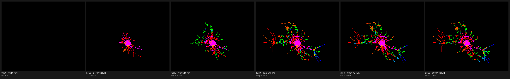
  <br><sub><b>biobloom</b> (kept): a filament skeleton that only extends when I move, with colonies blooming at hard efforts</sub>
</p>

Sleep seeded the morning colony, so a good night and a bad one looked
different from the first glance of the day:

<p align="center">
  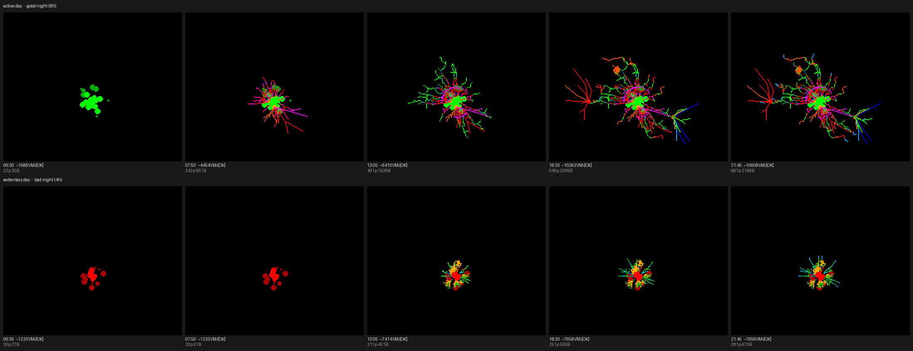
</p>

BioBloom shipped and ran on the wrist, and it was also where I learned how
strict the watchdog is. The face would render fine for hours, then crash
once the dish grew large enough. It took **four rounds of fixes** (cheaper
spine rendering, O(1) colour lookup, bounded per-frame regeneration,
cutting per-element method calls) to make a saturated dish safe. The
lessons are in
[`docs/watchdog-debugging.md`](docs/watchdog-debugging.md) so the next trip
takes one round instead of four.

### 6. V2: from clocks to moss

BioBloom was alive, but hard to *read*. For V2 I asked for something more
legible. The first answer put time on an axis:

<p align="center">
  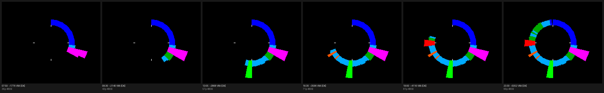
  <br><sub><b>dayring</b>: a 24 h heart-rate clock, wedges bulge with activity</sub>
</p>

<p align="center">
  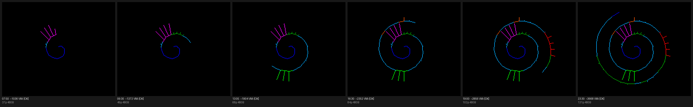
  <br><sub><b>dayspiral</b>: a nautilus winding out from midnight</sub>
</p>

They were legible, but **too clean and geometric**: they read as
infographics, not as the organic half of "two worlds." So the next round
dropped the time axis entirely and kept a day *summary* instead (total
movement, minutes per HR zone, discrete effort episodes), drawn three
organic ways:

<p align="center">
  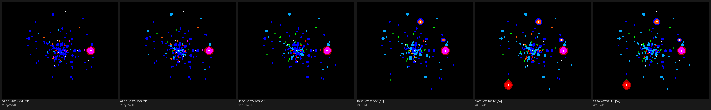
  <br><sub><b>nebula</b>: a gas cloud with haloed stars for efforts</sub>
</p>

<p align="center">
  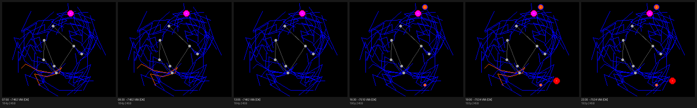
  <br><sub><b>neurons</b>: a dendrite network with firing synapses</sub>
</p>

<p align="center">
  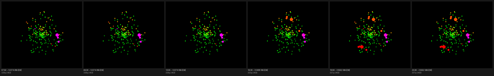
  <br><sub><b>moss</b>: a lumpy green bed with bright fruiting bodies</sub>
</p>

Moss won, but scattered grains didn't hold together as one thing. Three
variants pushed on cohesion (a solid *cushion*, satellite *colonies*, and
*lobes*). The hybrid of the first two, **moss_grove**, a solid cushion ringed
by tufts that merge into one organism, was tuned through a grid of
colour and sleep treatments:

<p align="center">
  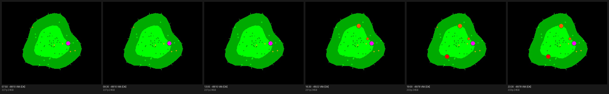
  <br><sub><b>moss_cushion</b>: the cohesion breakthrough, one solid two-tone mound</sub>
</p>

<p align="center">
  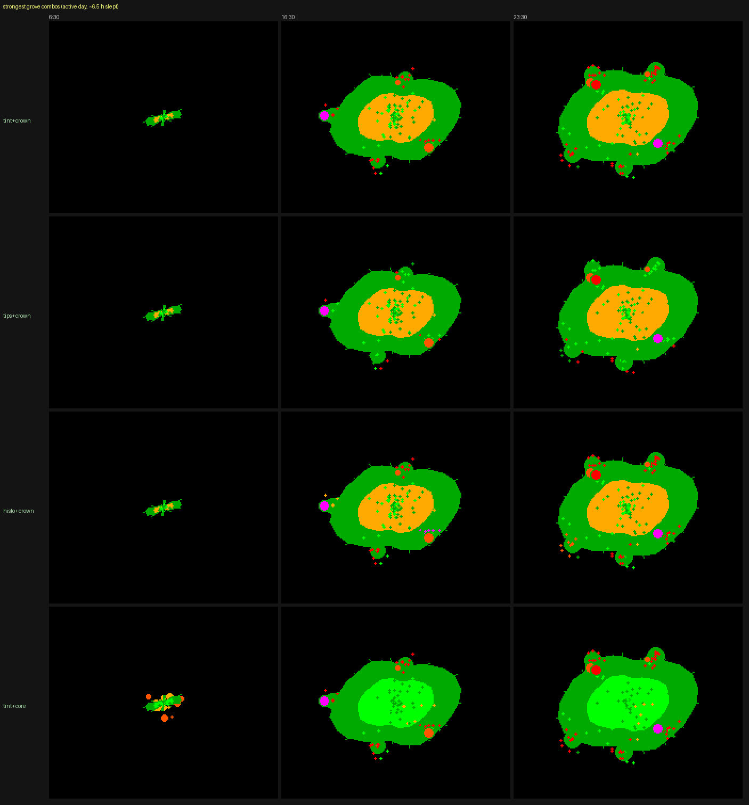
  <br><sub>The four strongest grove combinations across a day. Tufts tinted by dominant zone, sleep drawn on top, went forward</sub>
</p>

The same day, before and after:

<p align="center">
  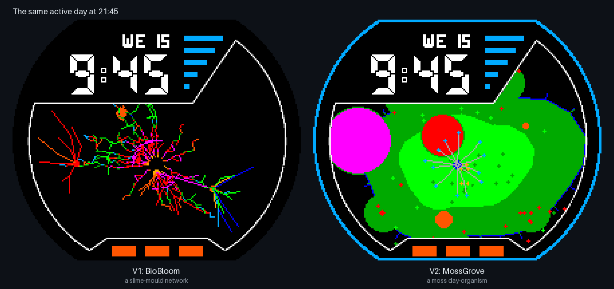
</p>

### 7. Tuning the organism

Wearing it surfaced dozens of small notes. Each became a sandbox comparison
sheet before any code changed. A few representative rounds:

**Sleep.** The first sleep marker was a clump of spores, but on a short
night it turned red and orange and read as *effort*. Three replacements
were compared across four kinds of night (rested 8 h, OK 6.5 h, short 4 h,
broken by three wake-ups). The **silver root star** won because it gives
sleep its own shape *and* its own colours:

<p align="center">
  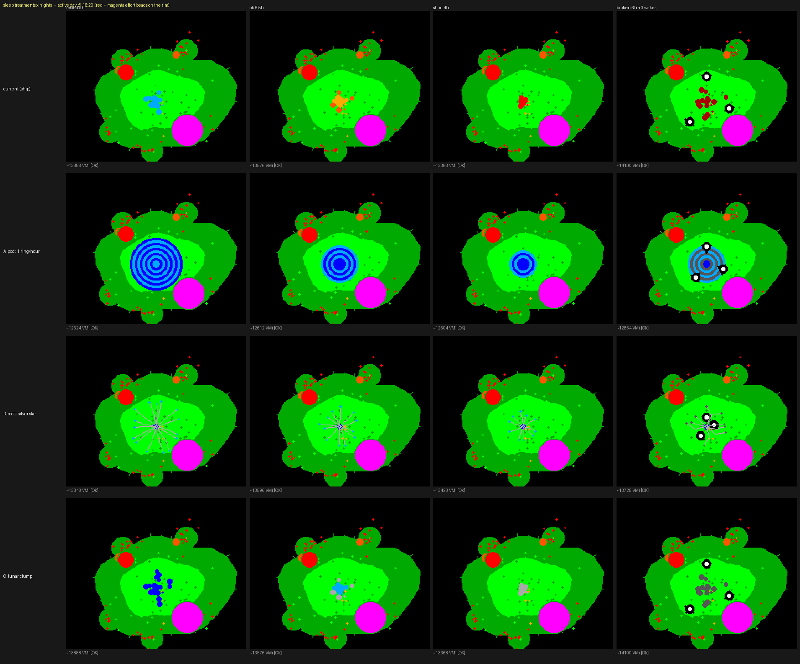
</p>

**Effort beads.** Where should beads sit, and should they overlap? Over
several rounds they went from riding tufts, to stalked "podetia," to a
golden-angle ring layout that grows with the moss:

<p align="center">
  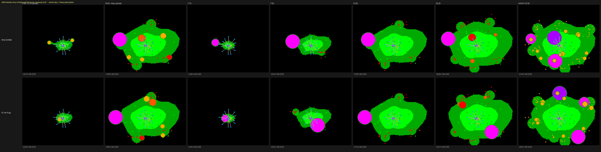
</p>

**Heart-rate colours.** The ramp was remapped onto Garmin's own zone
boundaries so a bead's colour means the same thing as the watch's zone
display. Option *C keep105* (bottom row) shipped:

<p align="center">
  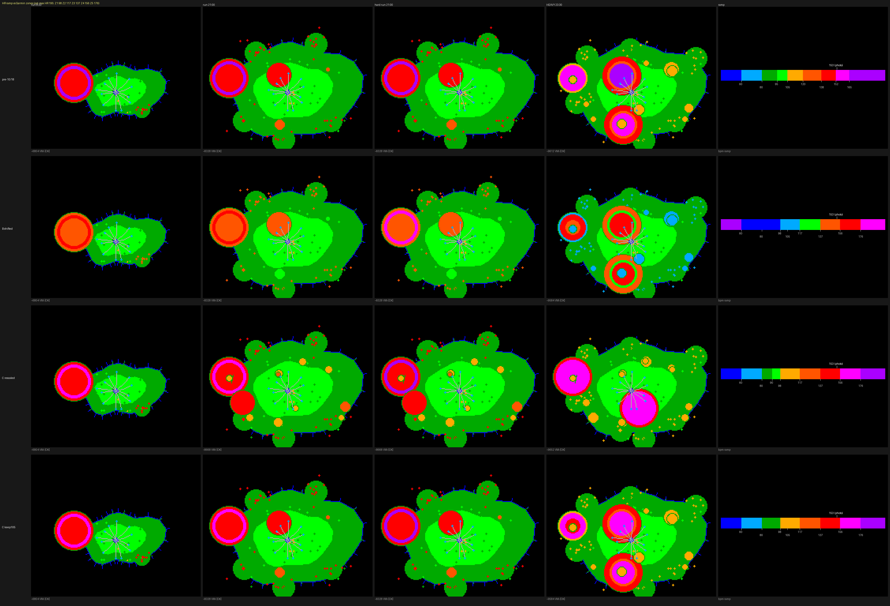
</p>

**The leading edge.** A 1 px dark-blue rim with 30 short perpendicular
tendrils gives the moss a growing edge:

<p align="center">
  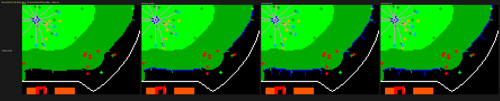
</p>

### 8. Polishing the chrome

**The north marker** used to ride a circle, which hid it under the clock or
off the glass for some bearings. Now it follows the screen's own edges and
draws last, so it's visible at every bearing:

<p align="center">
  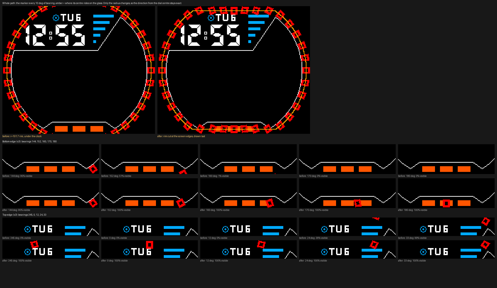
</p>

**The GPS indicator** went through five rounds of a pixel-art satellite
dish...

<p align="center">
  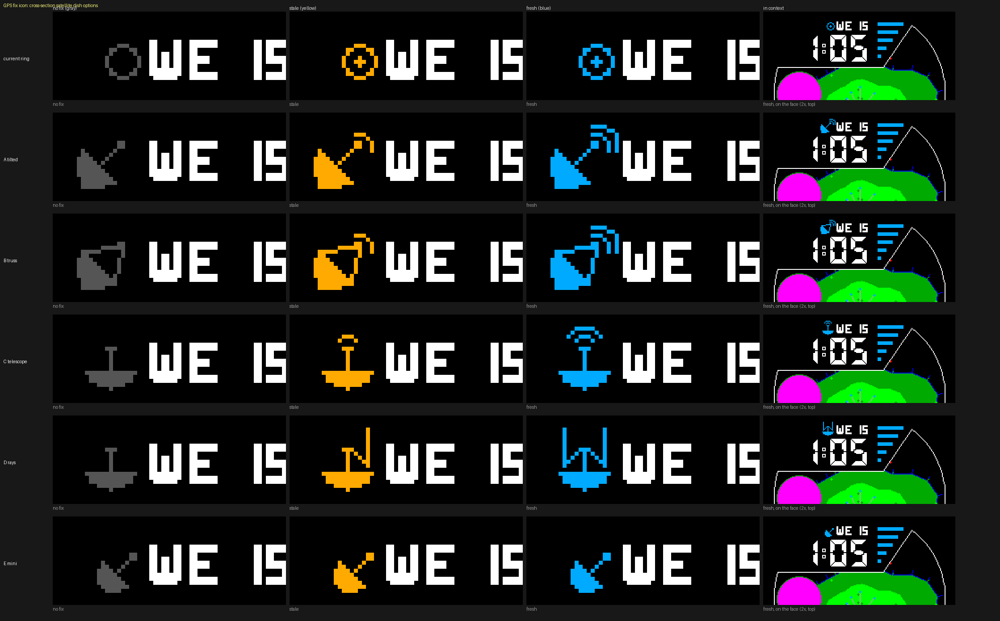
</p>

...and was then dropped entirely. The existing signal bars were re-tooled
to show GPS fix age instead (blue fresh / amber stale / grey none), and
phone connection moved to a blue ring around the glass:

<p align="center">
  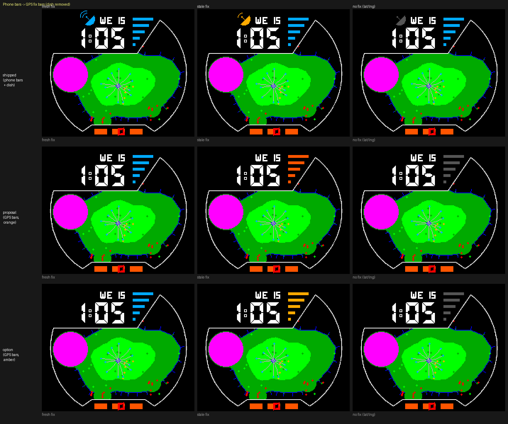
</p>

<p align="center">
  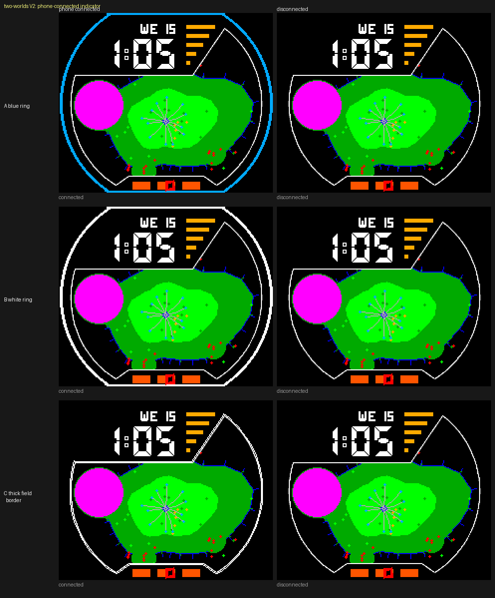
</p>

**Hand-placed anti-aliasing.** The display can't anti-alias, so the white
border got 245 precomputed grey pixels to soften its stair-steps, dark grey
where a pixel barely touches the ideal line and light grey where it mostly
does (bottom row, *dk + lt ramp*, shipped):

<p align="center">
  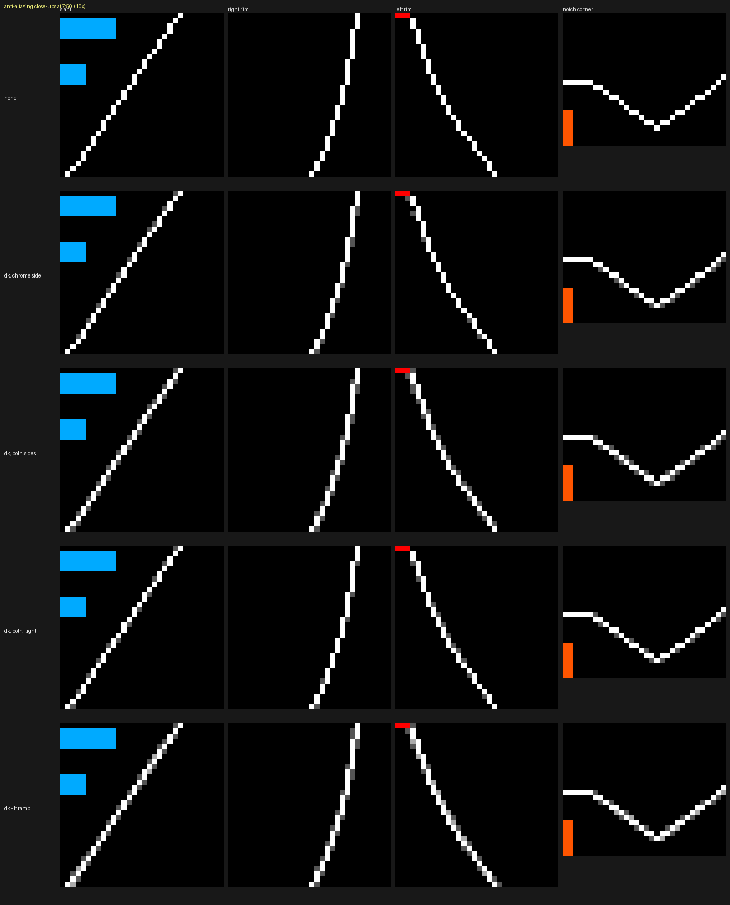
</p>

**CONTAINMENT BREACH** started as a real error state in V1, a red warning
when the day's dish was too big to save. In V2 it came back as an easter
egg once the day's movement passes the point where every part of the moss
is maxed out. Three banner styles were tried at several heights before one was
chosen:

<p align="center">
  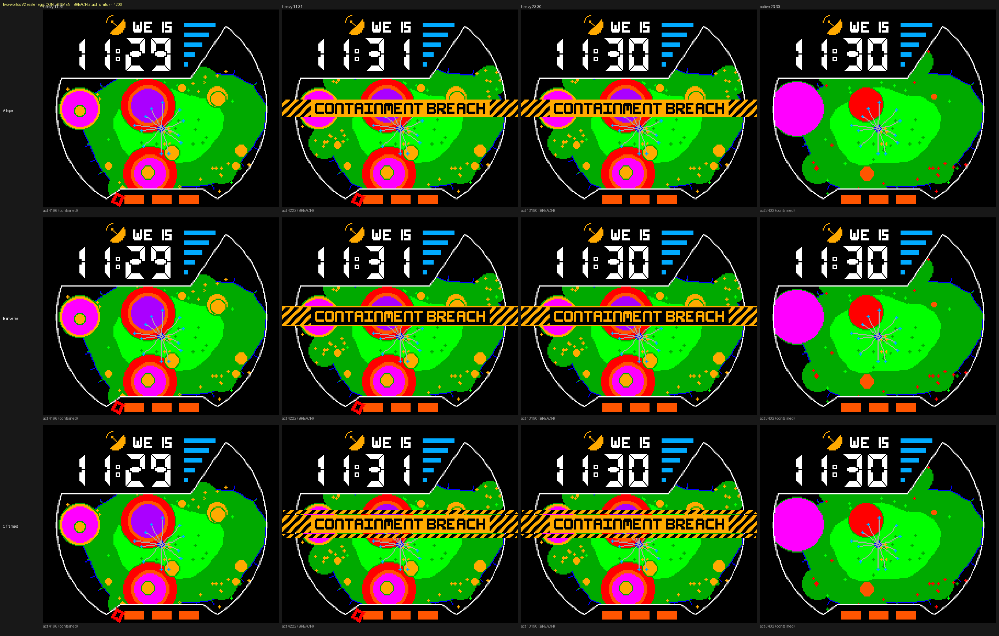
</p>

---

## Engineering inside 64 KB

The art is the visible part. Most of the work went into keeping it inside
the watch's limits.

- **The watchdog binds before RAM does.** A redraw gets roughly 25–30k VM
  instructions. The sandbox estimates cost, but it can't see per-call
  overhead, so the final check is always the Garmin simulator running a
  **pinned worst-case day** on the release build. The moss samples its
  outline once per frame into a lookup table and spends a fixed ink
  budget, so a saturated day degrades gracefully instead of crashing.
- **Memory.** V2 uses about **48–50 KB of the 59.8 KB** the simulator
  allows. A pinned worst-case day (16 six-ring beads, max cushion, a 10 h
  broken root star, and a 12-minute workout replay in the same frame) runs
  without a crash. One early win: Monkey C doesn't strip unused classes,
  so V2 first shipped with all of V1 inside it, unused. Listing core files
  per face dropped its runtime memory from 59.4 KB to 37.7 KB.
- **Zero allocation per tick.** Everything is allocated once at layout time.
  The day's record lives in flat integer arrays and is saved to the watch's
  object store, so the moss survives face switches and reboots and resets
  at midnight.
- **Workouts while the face is asleep.** Watch faces don't run while an
  activity is recording, so a run used to arrive as a single minute. The
  face now replays the gap from the watch's HR history, 12 minutes per
  redraw, so recorded workouts grow beads like any other effort.
- **Wrist-only bugs get a diagnostic build.** GPS behaviour that the
  simulator can't reproduce is debugged with a sideloadable diag build that
  swaps the moss for a readout one minute in ten: GPS sources, the last
  replayed gap, and a 3-hour HR sparkline.

<p align="center">
  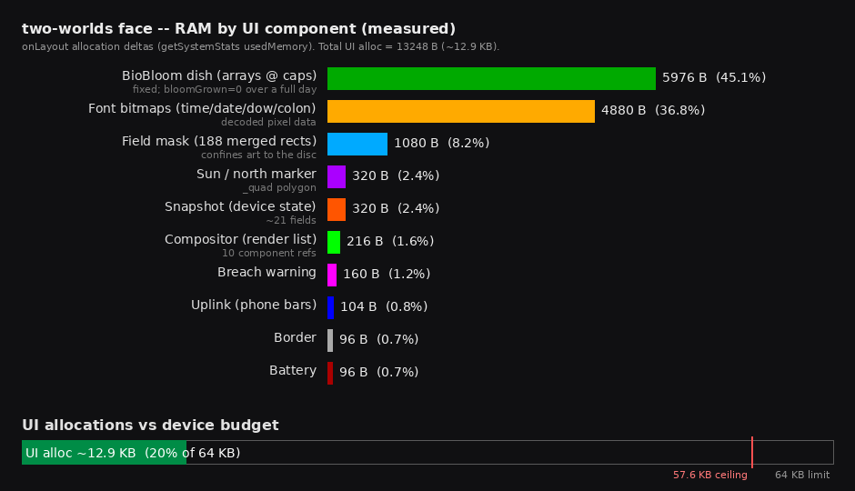
  <br><sub>Measured RAM per component (V1), from an on-simulator profiling test</sub>
</p>

Measurements and how to repeat them:
[`docs/memory-budget.md`](docs/memory-budget.md) ·
[`docs/watchdog-debugging.md`](docs/watchdog-debugging.md) ·
[`docs/api-2.4-notes.md`](docs/api-2.4-notes.md).

---

## Working with Claude

I started this project on a whim. I got a great deal on a running watch at a
garage sale, but I was not impressed with the user experience. I wanted a
glanceable record of my day, and the best the watch could do was display hard
numbers from sensors that I knew were not particularly precise. 6,078 steps in
a day? It bothered me knowing that number was really ±5%. I wanted something
that better represented the effort I made during a day, and was more honest
about the precision of the data involved.

My goal for the visual design was to separate the "hard/artificial" numbers
(clock, calendar, device state) from the "soft/bio" sensors (activity: steps,
heart rate, etc.). This reflects the real difference in precision between the
two "worlds", and it gave me a framework to base the design on. I knew I would
want to iterate on different algorithms and visualizations for the biometric
part of the display, so I made sure the architecture let that part be swapped
easily while keeping the "artificial" chrome I designed by hand.

My first step was a conversation with Opus 4.8. I wanted to:

- understand the feasibility of the project,
- sketch out the software stack at a high level so I could sanity-check it, and
- find out which sensors are exposed to a watch face.

The output of that conversation was a
[prompt to kick off the software side of the project](docs/kickoff-prompt.md)
in Claude Code.

Separately, I used a pixel-art program to make a first pass of the watch face
and the fonts I knew I'd need:

<p align="center">
  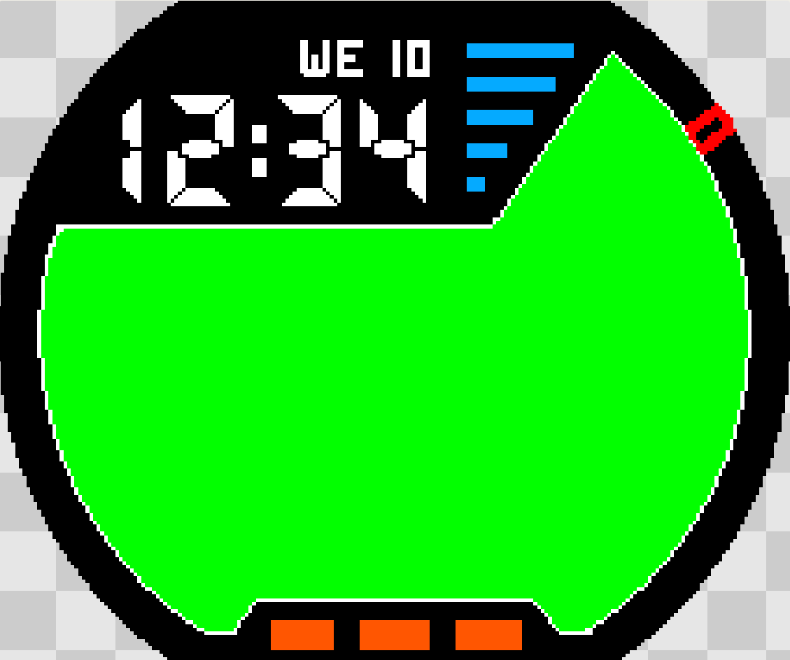
  <br><sub>The first face, drawn by hand in a pixel-art program</sub>
</p>

Once the project was kicked off and generating working test faces, I added my
hand-built references and began iterating on the algorithmic display.

Opus 4.8 (then 5.0, and now 5.5) handled the software implementation of my
ideas, chased down bugs, and found optimizations, but contributed no creative
direction to this project. Most of the work ran in Claude Code cloud sessions
where the agent provisions the Garmin toolchain itself. I wore every build and
approved or redirected every visual change (commit messages record those calls
as "owner: ...").

The process that made this work:

1. **Constraints written down early.** [`CLAUDE.md`](CLAUDE.md) and the
   `docs/` notes record the hardware limits, the API traps (functions
   documented as 1.3.0 that are really 3.0), and the simulator gotchas, so
   each new session starts with what earlier ones learned.
2. **A sandbox before any Monkey C.** New visuals are prototyped in Python
   and shown as comparison sheets, then the work *stops* for my sign-off
   before anything is ported. That rule is in the project instructions.
3. **The simulator as the final check.** Every port is checked in the real
   Garmin simulator against the sandbox render and a worst-case
   watchdog/RAM probe before the PRG in `bin/` is updated.
4. **The wrist as the final word.** Bugs that only showed up on the real
   watch (GPS returning nothing without a manifest permission, workouts
   arriving as one minute) were fixed from on-wrist observations and the
   diag build.

---

## Repository map

```
faces/two-worlds-v2/   the shipping face: MossGrove under the two-worlds chrome
faces/two-worlds/      V1: the same chrome over BioBloom
faces/strataflock/     the first generative face (sediment + murmuration)
faces/biobloom/        BioBloom full-screen, no chrome
faces/devface/         unstyled integration testbed; faces/flashtest: sideload check
core/src/              shared library: data, compositor, glyphs, astronomy,
                       generative engines (GenArt, MossGrove, BioBloom, ...)
sketches/              the Python sandbox, every exploration script, and out/
                       with all the comparison sheets in this README
docs/                  device notes, memory and watchdog playbooks, the kickoff
                       and Claude Design prompts, development guide
bin/                   ready-to-sideload PRGs
```

**Try it:** copy `bin/two-worlds-v2.prg` to the watch's `GARMIN/APPS`
folder over USB ([sideload guide](docs/sideload.md)).
**Build it:** see the [development guide](docs/development.md).
**Regenerate the README images:** `python3 sketches/readme_figs.py`; the
simulator hero comes from `sketches/sim_hero.py` (see its docstring).
