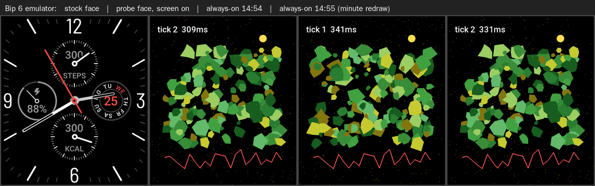

# Another platform? Amazfit Bip 6 (Zepp OS), 2026-11

**Question:** is there a cheaper, more modern watch with GPS and HR that could
run the MossGrove face? **Answer, so far:** the Amazfit Bip 6 (about $80,
Zepp OS 5, API 4.2, 390×450 square AMOLED) can. In Zepp's own emulator
running the real Bip 6 firmware, a watch face could draw freely on a canvas,
redraw every minute, and keep doing both in always-on mode. Nothing has been
ported and no real Bip 6 has been tested.

## The options considered

| Option | Verdict |
|---|---|
| Another Garmin | Least work: same Connect IQ code. Chrome needs a new layout for any screen that isn't 215×180. MIP Forerunners (55, 255) keep the 735XT's always-on reflective look; the Forerunner 165 is AMOLED. Instinct is mostly monochrome. |
| Bangle.js 2 (about £100) | Open hardware and firmware (it's the SMA Q3 reflashed with Espruino). JavaScript, 176×176 8-colour always-on reflective screen. HR is finicky, GPS slow, interpreter slow. |
| Amazfit (Zepp OS) | Cheap, good hardware, proprietary JavaScript SDK. The docs never say whether a *watch face* gets the canvas, so it was tested in the emulator below. |
| Custom firmware on an Amazfit | Not realistic: signed firmware on Zepp's own chips, no public schematics, and the raw-PPG → BPM processing is proprietary. Bangle.js 2 is this route already done. |
| No-name Chinese watches / cheap Wear OS | No code at all (faces are static image bundles) / 1–2 day battery. |

## What the probe showed (Bip 6 firmware v1.1.0, Zepp OS 5.0)

`probe/` is a throwaway watch face that tries every API the face would need
and logs `ZT key=value` lines to the firmware console.

| Needs | Result |
|---|---|
| Free drawing | `createWidget(widget.CANVAS)` works **in a watch face**: filled polygons, pixels, lines, circles, text, full 24-bit colour (RGB565 on the panel). `strokeArc` drew nothing, probably a parameter mismatch. |
| One redraw a minute | `new Time().onPerMinute(cb)` fires and the face redraws. When the screen is off without always-on, the callback is skipped ("not running") and the face redraws in `onResume` on wake. |
| Always-on | With Settings → Display → Always On Display → *Follow Watch Face* (the default), the firmware starts a **second instance** of the face with `getScene() === SCENE_AOD` (3). The canvas works there and `onPerMinute` redraws it. The emulator didn't enforce the ≤10 % lit-pixel / black-background guideline. |
| HR history | `HeartRate.getToday()` and `getLast()` work from a face (the emulator only fakes 24 values, so the full-day per-minute array is unconfirmed). |
| Position, compass | `Geolocation` and `Compass` both return values (fake: a Los Angeles fix, instantly). GPS cost on a real watch unknown. |
| Saving state | `LocalStorage` works and survives a reboot. |
| Keeping the screen on | `@zos/display` `setPageBrightTime` works from a face (used to test the minute redraw). |

**Not answered here:** real-chip speed (150 polygons took ~300 ms in the
emulator and nothing was killed even at 2.8 s, but QEMU's timing says nothing
about the hardware), always-on battery cost and store review, how full the
real HR history is, and installing on a real watch (`zeus preview` → QR code
→ Zepp phone app, which needs a Zepp account).

## How it was run (no GUI, no Zepp account)

The Zepp simulator (`simulator_2.1.2_linux_amd64.deb`) is an Electron shell
around a patched QEMU that boots the real device firmware. Everything below
skips the Electron app.

1. **Get the pieces** (not committed: ~75 MB simulator, ~150 MB per device):
   - simulator: `https://upload-cdn.zepp.com/zepp-applet-and-wechat-applet/20260717/simulator_2.1.2_linux_amd64.deb`,
     unpacked with `dpkg-deb -x` (not installed);
   - device images: `https://upload-cdn.huami.com/zeppos/simulator/download/emulatorList.json`
     lists them; Bip 6 is `.../20251027/bip6_os50_v110.zip` (`main.elf` + `norflash.bin`);
   - `npm i @zeppos/zeus-cli` (build only; `zeus dev` would need the Electron app).
2. **Boot:** `ZSIM=… ZFW=… ZRUN=… tools/boot.sh` (headless) or `tools/boot.sh window`.
3. **Build:** `zeus build` in `probe/` (after `npm i @zeppos/device-types`). The
   `.zab` is a zip holding a `.zpk`, a zip holding `device.zip`. `app.json`
   targets the Bip 6 by `deviceSource` (9765120, 9765121, 10158337).
4. **Install:** `WS_PATH=<node_modules>/ws node tools/install.js device.zip 1000777`.
   This is the Electron app's own protocol: a websocket to
   `ws://localhost:7833/SIMULATOR`, one binary frame
   `{"method":"Project","type":"install","appid":"<8 hex>","length":N,"file":"<zip bytes>"}`,
   then `{"method":"ChangeWatchFace","appid":…}`.
5. **Watch:** the firmware console (including the face's `console.log`) goes to
   `$ZRUN/serial.log`.
6. **Screenshots:** `python3 -I tools/cap.py $ZRUN/mon.sock $ZRUN out.png`. QEMU's
   own `screendump` comes out sheared, so this reads the PL111 LCD
   controller's frame address (`0x50305010`), dumps 390×450 RGB565 from
   guest memory and decodes it.
7. **Input:** keys via the monitor (`tools/mon.py $ZRUN/mon.sock "sendkey ret"`):
   Enter wakes, Home toggles face ↔ app list. Touch only works with
   `boot.sh window` and `tools/tap.sh X Y`. Monitor mouse events don't reach
   the touchscreen. `node tools/send.js '{"method":"ScreenRest"}'` is the
   simulator's wrist-down button (enters always-on).

## Next steps, if picked up again

1. Port the MossGrove mirror (`sketches/algos/moss_grove.py`) to a JavaScript
   Zepp face and run it in the emulator.
2. Buy a Bip 6 to measure speed and always-on battery, which only the real
   watch can answer.
